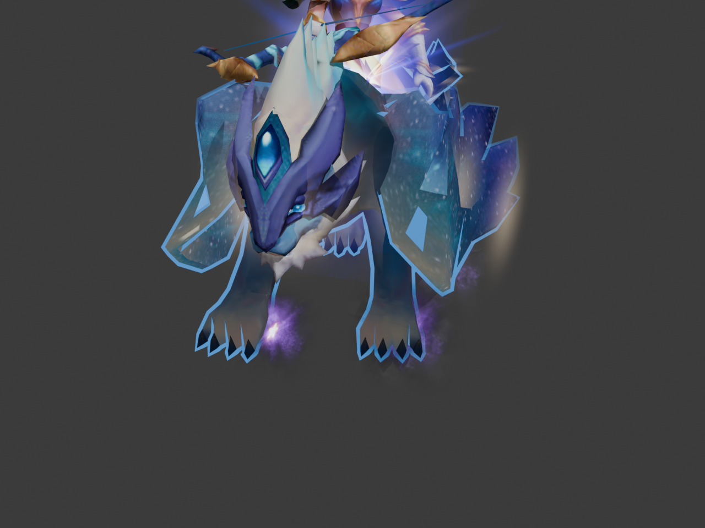

# BlenderMDX - WarCraft 3 (.mdx) Importer for Blender

[](https://www.blender.org/)
[](https://www.python.org/)
[](LICENSE)
[](https://github.com/nphucduc203/BlenderMDX/releases)

**English** | [Tiếng Việt](#-tiếng-việt)

A modern, high-performance addon for **Blender 4.2, 4.5, and 5.2 LTS** to import **WarCraft 3** 3D models (`.mdx` binary and `.mdl` text), textures (`.blp`), particle emitters, and animations with full fidelity matching Retera Model Studio and the in-game engine.



---

## ✨ Features

- **Dual MDX + MDL Import**: the binary `.mdx` and the text `.mdl` form of the same model land in the identical internal model, so geometry, skeleton, materials, tracks and emitters import the same way from either format.
- **Full MDX Chunk Support**:
  - `GEOS` & `GEOA`: Geosets, vertex groups, UV channels, normals, and geoset visibility animations.
  - `BONE` & `HELP`: Complete hierarchical skeleton with bones and helper nodes.
  - `ATCH`: Attachment points (e.g. `Hand, Left`, `Chest`, `Origin`).
  - `EVTS`: Event objects for sound cues and spell footprints.
  - `CLID`: Collision shapes for bounds and physics hitboxes.
  - `PRE2` & `RIBB`: WarCraft 3 `ParticleEmitter2` and Ribbon emitters.
  - `TXAN` & `GLBS`: Texture coordinate animations (`TVertexAnims`) and global sequences.
  - `CAMS`: Model cameras imported as Blender cameras (with animated target empty, Track To constraint, and FOV → focal length animation).
  - `LITE`: Omnidirectional/directional lights parented into the bone hierarchy, with animated color and intensity.
  - **Reforged Compatibility**: loads version 800 *and* version 900/1000 files (unknown versions warn instead of aborting) and skips Reforged-only chunks (`CORN`, `BORN`, `FAFX`). Reforged-only *fields* (the 256-byte model name, material shader name, emissive/fresnel layer values) are not parsed yet, so version 900+ materials keep classic defaults.

- **High-Fidelity Texturing & Shading**:
  - Direct native `.blp` image decoding (JPEG & DXT1/DXT3/DXT5 compressed BLP formats).
  - Eliminates black outlines around semi-transparent edges using separate alpha and RGB color math.
  - **Multi-Layer Additive Materials**: Seamlessly layers additive textures (e.g. animated star shimmers, galaxy cloaks) over base diffuse surfaces with real-time UV translation.
  - **Animated Material Layers**: `KMTA` alpha tracks and TXAN `KTAT`/`KTAS` UV scroll & scale are baked into the shader node tree, so glow fades and scrolling UVs play in the viewport.

- **WarCraft 3 `ParticleEmitter2` Conversion**:
  - Converts WC3 particle emitters into native Blender particle systems in the `"WarCraft 3 Particles"` collection.
  - Zero-gravity setting (`gravity = 0.0`) ensures aura and paw effects hover and swirl naturally rather than falling like snow.
  - Age/Lifetime color fades driven by `ShaderNodeParticleInfo` matching `segment_colors` and `segment_alphas`.
  - Dynamic GPU-driven UV flipbook shaders for animated particle sheets (e.g. 4x4 fire, 2x2 star bursts).

- **Animation Sequence Controller**:
  - Dedicated **WarCraft 3** tab in the 3D Viewport sidebar (`N` panel) listing all model sequences (`Stand`, `Walk`, `Attack`, `Spell`, `Death`, etc.).
  - Isolated action naming and automatic purging of orphaned actions, preventing animation collisions when deleting objects or importing multiple models.

- **Game Engine (.glb) Export**:
  - One click produces a single standard glTF 2.0 binary: embedded textures, one glTF animation per WarCraft 3 sequence, per-layer primitives, and `wc3_*` extras (blend mode, layer alpha, tint, emitter parameters) for engines that want to restore additive blending or spawn particles.
  - Exports only the model itself (armature + meshes + camera/lights) — Blender-side particle preview helpers never leak into the file.
  - WC3 shader nodes that glTF cannot represent are temporarily flattened to `texture → Base Color / Alpha / Emission` so textures always survive the export; your original materials are restored afterwards.

---

## 🚀 Installation

### Option 1: Release ZIP (Recommended)
1. Download `io_scene_warcraft_3.zip` from the [Latest Release](https://github.com/nphucduc203/BlenderMDX/releases/latest).
2. Open **Blender** (version 4.2 or newer, including 5.2 LTS).
3. Go to **Edit** > **Preferences** > **Add-ons**.
4. Click the downward arrow in the top right and choose **Install from Disk...**.
5. Select the downloaded `io_scene_warcraft_3.zip` file.
6. Enable the checkbox for **WarCraft 3 .mdx importer**.

### Option 2: Manual Installation via Git
Clone this repository directly and copy the `io_scene_warcraft_3` folder into your Blender addons directory:

```bash
git clone https://github.com/nphucduc203/BlenderMDX.git
```

**Addons path on Windows:**
```
%APPDATA%\Blender Foundation\Blender\<version>\scripts\addons\io_scene_warcraft_3
```

---

## 🎮 Usage

### Importing a model
1. In Blender, navigate to **File** > **Import** > **WarCraft 3 (.mdx)**.
2. Select your `.mdx` file.
3. Configure import options in the right-hand panel:
   - **Auto Import Textures (.blp)**: Automatically search for `.blp` files in the model's directory or subfolders.
   - **Convert Particle Emitters**: Convert `ParticleEmitter2` nodes into Blender particle systems.
   - **Global Scale**: Default is `0.03` (optimal for Warcraft III scale in Blender).
   - **Team Color**: Choose player team color (Red, Blue, Teal, Purple, etc.).
4. Click **Import WarCraft 3 (.mdx)**.

### Switching animations
1. Select the model's Armature.
2. Open the Sidebar by pressing `N` in the 3D Viewport.
3. Switch to the **WarCraft 3** tab.
4. Click any sequence in the **Animation Sequences** list to play!

### Exporting to Game Engines (.glb)
1. In the **WarCraft 3** sidebar tab, press **Export GLB for Game Engines** (or `File > Export > WarCraft 3 (.glb)`). One standard glTF 2.0 file is produced:
   - 1 geoset with N layers exports as N primitives in a single glTF mesh (skin + glow + star shimmer stay separate surfaces).
   - Exact `layerAlpha`, tint and `wc3_blend: "additive"` ride in `extras`; additive layers are `BLEND` + `doubleSided` + `KHR_materials_emissive_strength`.
   - Every WarCraft 3 sequence becomes its own glTF animation, and each `ParticleEmitter2` stays a named `W3_Emitter_*` node on its bone carrying its emitter parameters, so an engine can spawn particles from it.
   - glTF has no additive blend mode, so a glow layer reads as alpha-blended emission unless the engine opts into the `extras` hint.
2. **Previewing the GLB in Blender**: Blender's glTF importer draws each bone as a stretched octahedron with an Icosphere custom shape. This is a *display artifact of the importer* — the shapes are not in the file and game engines do not show them. Press **Fix glTF Display (Hide Spheres)** in the WarCraft 3 tab to clean the viewport.

> **Note**: both `.mdx` (binary) and `.mdl` (text) are imported through the same menu — the format is detected from the file itself, not the extension.

### Checking an exported .glb (Godot viewer)
`tools/wc3_glb_viewer/` is a self-contained Godot 4 scene for inspecting what the exporter actually produced:
1. Copy the folder into your Godot project, so it becomes `res://wc3_glb_viewer/`.
2. Run `viewer.tscn` (or make it the main scene). It loads `res://wc3_export_test/2_95.glb` when that file exists, otherwise it opens a file dialog; `--model=res://path/file.glb` also works.
   The `.glb` is parsed at runtime with `GLTFDocument`, so it needs no Godot `.import` cache and any absolute path on disk (`D:\...\model.glb`) opens directly.
3. Keys: `O` open another `.glb`, `←`/`→` (or `A`/`D`) previous/next sequence, `Space` pause, drag to orbit, wheel to zoom, `F` re-frame. Every sequence is forced to `LOOP_LINEAR`, so it keeps animating instead of playing once. The status bar prints the mesh / surface / animation / bone counts the file really contains, which catches silent export losses immediately.

> **Lưu ý**: bản `.mdl` (văn bản) cũng nhập qua cùng menu — định dạng được nhận từ nội dung file, không phải phần đuôi.

---

## 📋 Changelog

### v1.9.0
- **One export, one file**: *Export Lossless GLB* and *Export Compatible GLB* are replaced by a single **Export GLB for Game Engines** (`File > Export > WarCraft 3 (.glb)`, `warcraft_3.export_glb`). The result is standard glTF 2.0: per-layer primitives, exact `layerAlpha`/tint/`wc3_blend` in `extras`, `KHR_materials_emissive_strength` on additive layers, one animation per sequence, and named `W3_Emitter_*` nodes on bones carrying emitter parameters.
- **Removed**: the third `warcraft_3.export_godot_glb` operator, the companion `godot_tools/` post-import scripts and the standalone `godot_addon/warcraft_3_mdx` Godot plugin. Nothing in the Blender addon referenced them.
- **Additive layers fixed for stock engines**: glTF has no additive mode, and WarCraft 3 additive textures carry an *unused* alpha channel (opaque black outside the glow), so a plain alpha blend painted dark grey plates over the scene. The exporter now writes a luminance-alpha copy of those textures (`<texture>_addmask`), so any engine that only knows `BLEND` adds light instead of darkening. Verified in Godot 4.7.2 on `2 (95).mdx`: the halo layers changed from dark wedges to a soft glow, at +0.45 MB.
- **Exporting from a scene that holds several models no longer leaks their animations**: glTF's "all actions" mode exports every action in the .blend, so the postprocessor keeps only the animations tagged as sequences of the armature being exported.
- Verified end to end: `2 (95).mdx` → 3.7 MB GLB → Godot 4.7.2 shows 14 meshes / 28 surfaces, 15 emissive surfaces and 11 animations (Attack 1.000 s, Death 2.000 s, Stand 1.333 s, …) with the skeleton really posing — `Bone_Hand_L` moves between sampled frames. Re-opening the same GLB in Blender returns all 102 bones, 28 material slots and 11 actions.
- Known glTF limit: additive glow layers arrive as alpha-blended emission (`BLEND_MODE_MIX`) because glTF 2.0 has no additive mode; an engine can flip them from `extras.wc3_blend == "additive"`.

### v1.8.0
- **Animated layer alpha (`KMTA`)**: a layer's alpha track now keyframes that layer's alpha multiplier in the shader graph. The track value *replaces* the static layer alpha (it is never multiplied by it), and step/linear interpolation is kept — 151 such tracks exist in the classic corpus (glow pulses, shimmer fades).
- **Layer alpha works for `.mdl` too**: text models feed the same `layer.material_alpha` field, plus the `TextureAnimID` spelling of a layer's texture animation.
- **Texture-animation scale (`KTAS`)**: TXAN scale tracks drive the Mapping node's Scale next to Location.
- Known limits: `KMTF` flipbook frames are not keyframed (Blender 5.2 rejects animating an image node's `image` property, so the layer keeps its first frame), `KTAR` UV rotation is not applied, and the extra layers of an AddAlpha/Modulate primary material remain export metadata (`wc3_sec_layers`) rather than a live second shader.

### v1.7.0
- **Text `.mdl` import**: `File > Import > WarCraft 3 (.mdx, .mdl)` reads the text format through the same pipeline — geosets, layers, bones/helpers/attachments, animation tracks (with or without the `LineType` keyword), pivot points, and the `PRE2` / `RIBB` / `Light` / `Camera` / `CollisionShape` / `EventObject` blocks. The format is sniffed from the file contents, so a mislabelled extension still imports.
- **Tag-driven geoset reading**: `VRTX/NRMS/PVTX/GNDX/MTGC/MATS/UVAS/UVBS` are read in any order instead of Blizzard's exact write order, so models written by other tools no longer abort mid-geoset; an unknown sub-chunk now warns and keeps what was parsed.
- **Correct geoset tint colors**: `GEOA` static color is RGB, only the animated `KGAC` track is BGR. Red and blue used to be swapped on every tinted geoset (`2 (95).mdx` geoset 17 imported as peach instead of light blue).
- **Correct `PRE2` emitter area**: the binary reader assigned `length` to `width` and the other way around.
- **Warcraft objectIds are not list indices**: pivots, bone parenting, skin binding and light/emitter parenting resolve nodes by `objectId`. The old code assumed ids were exactly `0..N-1` in sorted order, which models with dropped or renumbered nodes violate.

### v1.6.0
- **Industry-Standard 2-Tier Architecture**:
  - **Export Lossless GLB + WC3 Extensions**: 1 geoset with N layers exports as N primitives in a single glTF mesh! Preserves exact `layerAlpha`, color tints, and `BLEND_MODE_ADD` metadata in `extras` without fake alpha or luminance gating. Includes 17 bone-attached particle emitter markers.
  - **Export Compatible GLB (Standard PBR)**: Preserves the frozen PBR approximation (`layerAlpha²` + boosted emission) for universal viewers without custom shaders.
  - **Dual Export UI**: Two distinct buttons in the sidebar, properties panel, and File > Export menu.
  - **Godot 4 Multi-Surface Post-Import**: Automatically restores true additive blending on all multi-primitive surfaces and spawns `GPUParticles3D` on bones.

### v1.5.5
- **Direct GLB Binary Post-Processor (`postprocess_wc3_glb`)**:
  - Enforces exact glTF 2.0 material properties directly into the exported `.glb` binary (`alphaMode`, `alphaCutoff`, `doubleSided`, `pbrMetallicRoughness`, `emissiveTexture`, `emissiveFactor`, `KHR_materials_emissive_strength`) parsed from `extras`.
  - Ensures 100% compliant 4-byte aligned GLB files for Godot, Unity, Unreal Engine & web engines.
  - Multi-layer material separation and geoset visibility improvements.

### v1.4.4
- **Godot Engine 4 Pipeline Perfection (glTF Extras & Particle Emitters)**:
  - GLB export now writes custom metadata into glTF `extras`: marks additive materials (`wc3_blend: "additive"`), layer tint, and layer alpha.
  - Particle emitters (`W3_Emitter_*`) are now exported as lightweight bone-attached marker nodes carrying particle parameters (rate, speed, gravity, color ramp, lifetime, size, texture) in `extras`.
  - Added companion Godot 4 post-import script `wc3_post_import.gd`: automatically restores true `BLEND_MODE_ADD` + `SHADING_MODE_UNSHADED` on additive surfaces and spawns working `GPUParticles3D` on bones!
  - Added standalone Godot 4 Addon (`godot_addon/warcraft_3_mdx`): directly imports `.mdx` models and `.blp` textures natively in Godot 4 with `Skeleton3D`, `ArrayMesh`, `AnimationPlayer`, and `GPUParticles3D`.

### v1.4.3
- **Semi-transparent effect meshes visible again** (e.g. splash auras such as Moon Priestess `HeroMoonPriestess.017`): layered WC3 effects now export with `alpha = layerAlpha² × textureAlpha` plus boosted emission (`KHR_materials_emissive_strength`, exported reliably by linking the raw texture into Emission). One quad adds as much light as WC3 additive blending, and stacked quads keep getting brighter instead of darkening into a black plate.
- **Full-alpha additive glows** (layer alpha ≥ 0.9) keep the luminance-gated alpha from v1.4.2: bright texels glow, dark texels stay invisible — no black plates, no dark smudges.
- Verified on `2 (95).mdx`: 0% black pixels (was 32.5%), aura visible at WC3 strength, rider/mount colors match the MDX import.

### v1.4.2
- **Fixed the "black plate" GLB bug**: additive WC3 materials (glows, splashes, ribbons) never occlude in-game, but the flattened export material used the texture's alpha channel with `BLEND` — dark additive textures (e.g. splash quads) re-imported as giant opaque black plates covering the model. Additive materials now export with `alpha = luminance(color) × texture alpha`, so bright texels glow and dark texels stay invisible, matching WC3.
- **Balanced glow brightness**: the flat material combined diffuse lighting with full-strength emission, double-brightening everything. Emission strength is now 0.3, measured closest to the original WC3 render (pixel-diff improved ~43%).
- Round-trip verified on `2 (95).mdx` (Moon Priestess): black pixels 32.5% → 0%, color parity restored, 12 sequences + camera intact.

### v1.4.1
- **Godot GLB export rewritten**: exports only the model (armature + meshes + camera/lights) instead of the whole scene, so Blender-side particle preview helpers (`W3_Inst_*` quads at −1000, `W3_Emitter_*`) and unrelated scene objects no longer leak into the GLB.
- **Textures survive glTF export**: WC3 materials use ObjectInfo tints and Add-Shader emission that the glTF exporter cannot translate (re-imported models rendered black/untextured). Export now temporarily swaps in flat `texture → Base Color / Alpha / Emission` materials and restores your originals afterwards.
- **Cameras exported** (`export_cameras`): MDX cameras and their FOV animation now reach Godot.
- Round-trip verified: re-importing the exported GLB shows all 12 sequences, the camera, and correctly textured meshes (tiger mount no longer black).

### v1.4.0
- **Reforged MDX Support (VERS 1000)**: files saved by WarCraft 3: Reforged tools now import; unknown versions warn instead of aborting.
- **Global Sequences (GLBS)**: tracks bound to a global sequence are loop-unrolled into every animation sequence instead of being dropped or mis-shifted.
- **Cameras (`CAMS`)**: imported as Blender cameras with target empty + Track To constraint, animated position/target, and FOV animation converted to focal length.
- **Lights (`LITE`)**: imported as Blender lights attached to their node bone, with animated color and intensity that follow sequence switching.
- **Crash Fix**: hardened custom split-normals import against a Blender 5.x crash (zero-length normals + session state previously killed Blender on models like SalvationSpire). Verified importing 148 models back-to-back without a crash.
- **Attachment visibility (`KATV`) and event tracks (`KEVT`)** are now parsed and stored instead of discarded.
- **Safer Cleanup**: orphaned-action purging now only touches actions created by this addon, never the user's own actions.
- **Lighter Files**: nodes without any animation no longer get placeholder fcurves in every action (fewer fcurves/keyframes, identical playback).
- **Parser Hardening**: unknown sub-chunks inside layers, nodes, and geoset animations resync instead of raising; `.mdl` files produce a clear conversion hint.
- **Compatibility**: verified on Blender 5.2.2 LTS (Python 3.13) and 4.2+.

### v1.3.0
- **Multi-layer Additive Texture Support**: Fully supports Material Layer 2 with Additive blending and dynamic `TVertexAnims` UV animation (e.g. `2 (95)_8.blp` star shimmer on wings).
- **Accurate ParticleEmitter2 System**: Zero-gravity floating particles, Age/Lifetime color fades, and UV flipbooks.
- **Particle UI Controls**: Added **Convert WC3 Particle Emitters** and **Toggle Particle Visibility** buttons in the sidebar.
- **Cross-File Animation Bug Fix**: Isolated actions by Armature and automatically purged orphaned actions upon deletion and re-import.
- **Compatibility**: Verified compatibility with Blender 5.2 LTS and Python 3.12.

---

# 🇻🇳 Tiếng Việt

**Addon hiện đại, hiệu năng cao cho Blender 4.2, 4.5 và 5.2 LTS** để nhập (import) mô hình 3D **WarCraft 3** (`.mdx`), texture (`.blp`), hệ hạt (particle emitter) và animation với độ trung thực đầy đủ, tương đương Retera Model Studio và engine trong game.

---

## ✨ Tính năng

- **Hỗ trợ đầy đủ các chunk MDX**:
  - `GEOS` & `GEOA`: Geoset, vertex group, kênh UV, normal và animation hiển thị geoset.
  - `BONE` & `HELP`: Bộ xương phân cấp đầy đủ gồm bone và node hỗ trợ.
  - `ATCH`: Điểm gắn attachment (ví dụ `Hand, Left`, `Chest`, `Origin`).
  - `EVTS`: Đối tượng sự kiện cho hiệu ứng âm thanh/dấu chân phép.
  - `CLID`: Hình dạng va chạm dùng cho bound và hitbox vật lý.
  - `PRE2` & `RIBB`: `ParticleEmitter2` và Ribbon emitter của WarCraft 3.
  - `TXAN` & `GLBS`: Animation tọa độ texture (`TVertexAnims`) và global sequence.
  - `CAMS`: Camera của model được import thành camera Blender (kèm empty đích có animation, ràng buộc Track To, và animation FOV → tiêu cự).
  - `LITE`: Đèn omni/directional gắn vào hierarchy bone, có animation màu sắc và cường độ.
  - **Tương thích Reforged**: chấp nhận MDX phiên bản 800 *và* 1000, bỏ qua an toàn các chunk riêng của Reforged (`CORN`, `BORN`, `FAFX`).

- **Texture & Shading độ trung thực cao**:
  - Giải mã trực tiếp ảnh `.blp` (cả BLP nén JPEG & DXT1/DXT3/DXT5).
  - Khử viền đen quanh các cạnh bán trong suốt nhờ tính toán riêng kênh alpha và màu RGB.
  - **Material additive nhiều lớp**: phủ texture additive (ví dụ lấp lánh sao chuyển động, áo choàng dải ngân hà) lên bề mặt diffuse gốc với chuyển dịch UV theo thời gian thực.

- **Chuyển đổi `ParticleEmitter2` của WarCraft 3**:
  - Chuyển emitter WC3 thành hệ hạt Blender gốc trong collection `"WarCraft 3 Particles"`.
  - Gravity = 0 giúp các hào quang/hiệu ứng quanh chân lơ lửng và xoay tự nhiên thay vì rơi như tuyết.
  - Màu chuyển theo Age/Lifetime bằng `ShaderNodeParticleInfo` khớp với `segment_colors` và `segment_alphas`.
  - Shader UV flipbook trên GPU cho các sheet hạt động (ví dụ lửa 4x4, sao nổ 2x2).

- **Bộ điều khiển Animation Sequence**:
  - Tab **WarCraft 3** riêng trong sidebar viewport (`N`) liệt kê mọi sequence của model (`Stand`, `Walk`, `Attack`, `Spell`, `Death`,...).
  - Đặt tên action cách ly và tự động dọn action mồ côi, tránh xung đột animation khi xóa object hoặc import nhiều model.

- **Xuất sang Game Engine (.glb)**:
  - Một cú click tạo duy nhất một file glTF 2.0 chuẩn: texture nhúng, mỗi sequence WarCraft 3 là một animation riêng, geoset nhiều layer thành nhiều primitive, kèm `extras` (`wc3_blend`, `wc3_layer_alpha`, `wc3_tint`, tham số emitter) để engine phục hồi blending cộng màu hoặc sinh hạt.
  - Chỉ xuất đúng model (armature + mesh + camera/đèn) — các object preview hạt phía Blender không bao giờ lọt vào file.
  - Các node shader WC3 mà glTF không biểu diễn được sẽ được "làm phẳng" tạm thời thành `texture → Base Color / Alpha / Emission` để texture luôn giữ được khi xuất; material gốc của bạn được phục hồi nguyên vẹn sau đó.

---

## 🚀 Cài đặt

### Cách 1: File ZIP từ Release (khuyên dùng)
1. Tải `io_scene_warcraft_3.zip` từ [Release mới nhất](https://github.com/nphucduc203/BlenderMDX/releases/latest).
2. Mở **Blender** (phiên bản 4.2 trở lên, gồm 5.2 LTS).
3. Vào **Edit** > **Preferences** > **Add-ons**.
4. Bấm mũi tên hướng xuống ở góc trên bên phải, chọn **Install from Disk...**.
5. Chọn file `io_scene_warcraft_3.zip` vừa tải.
6. Bật checkbox **WarCraft 3 .mdx importer**.

### Cách 2: Cài thủ công qua Git
Clone repository này và copy thư mục `io_scene_warcraft_3` vào thư mục addon của Blender:

```bash
git clone https://github.com/nphucduc203/BlenderMDX.git
```

**Đường dẫn addon trên Windows:**
```
%APPDATA%\Blender Foundation\Blender\<phiên bản>\scripts\addons\io_scene_warcraft_3
```

---

## 🎮 Sử dụng

### Import mô hình
1. Trong Blender, vào **File** > **Import** > **WarCraft 3 (.mdx)**.
2. Chọn file `.mdx` của bạn.
3. Cấu hình các tùy chọn import trong panel bên phải:
   - **Auto Import Textures (.blp)**: Tự động tìm file `.blp` trong thư mục của model hoặc thư mục con.
   - **Convert Particle Emitters**: Chuyển node `ParticleEmitter2` thành hệ hạt Blender.
   - **Global Scale**: Mặc định `0.03` (tối ưu cho tỉ lệ Warcraft III trong Blender).
   - **Team Color**: Chọn màu đội người chơi (Đỏ, Xanh dương, Xanh ngọc, Tím,...).
4. Bấm **Import WarCraft 3 (.mdx)**.

### Chuyển đổi animation
1. Chọn Armature của model.
2. Mở Sidebar bằng phím `N` trong 3D Viewport.
3. Chuyển sang tab **WarCraft 3**.
4. Bấm vào bất kỳ sequence trong danh sách **Animation Sequences** để phát!

### Xuất sang Game Engine (.glb)
1. Trong tab sidebar **WarCraft 3**, bấm **Export GLB for Game Engines** (hoặc `File > Export > WarCraft 3 (.glb)`). Chỉ một file glTF 2.0 chuẩn được tạo ra:
   - 1 geoset có N layer xuất thành N primitive trong cùng 1 mesh glTF (skin + glow + star shimmer vẫn là các surface riêng).
   - `layerAlpha` gốc, màu tint và `wc3_blend: "additive"` nằm trong `extras`; layer additive là `BLEND` + `doubleSided` + `KHR_materials_emissive_strength`.
   - Mỗi sequence WarCraft 3 thành một glTF animation riêng; mỗi `ParticleEmitter2` ở lại thành node `W3_Emitter_*` gắn trên bone kèm tham số emitter để engine sinh hạt.
   - glTF không có chế độ cộng màu, nên lớp phát sáng hiển thị như alpha-blend + emission trừ khi engine đọc `extras`.
2. **Xem trước GLB bằng Blender**: glTF importer của Blender vẽ mỗi bone thành khung bát diện giãn dài kèm hình Icosphere. Đây là *artifact hiển thị của importer* — các hình này không nằm trong file và game engine không hiển thị chúng. Bấm **Fix glTF Display (Hide Spheres)** trong tab WarCraft 3 để dọn sạch viewport.

> **Lưu ý**: cả `.mdx` (nhị phân) và `.mdl` (văn bản) đều nhập qua cùng một menu — định dạng được nhận từ nội dung file, không phải phần đuôi.

---

## 📋 Lịch sử thay đổi (Tóm tắt)

- **v1.9.0** — Một exporter duy nhất, bỏ toàn bộ phần Godot companion:
  - *Export Lossless* + *Export Compatible* gộp thành **Export GLB for Game Engines** (`warcraft_3.export_glb`): glTF 2.0 chuẩn, mỗi layer một primitive, `layerAlpha`/tint/`wc3_blend` trong `extras`, emission cho layer additive, mỗi sequence một animation, node `W3_Emitter_*` trên bone.
  - Xoá operator thứ ba `warcraft_3.export_godot_glb`, thư mục `godot_tools/` và addon Godot `godot_addon/warcraft_3_mdx` (Blender addon không tham chiếu chúng).
  - Đã kiểm chứng: `2 (95).mdx` → GLB 3.3 MB → Godot 4.7.2 hiển thị 14 mesh / 28 surface, 15 surface phát sáng, 11 animation, xương cử động thật.
  - Giới hạn glTF: lớp additive vào Godot là `BLEND_MODE_MIX` + emission (glTF không có chế độ cộng màu); engine có thể tự bật qua `extras.wc3_blend`.
- **v1.8.0** — Animation lớp vật liệu:
  - Track alpha `KMTA` của layer nay được keyframe lên node nhân alpha trong shader graph; giá trị track **thay thế** alpha tĩnh (không nhân thêm) và giữ kiểu nội suy step/linear.
  - `.mdl` cũng cấp cùng trường `material_alpha`, nhận thêm tên `TextureAnimID` cho TVertexAnim của layer.
  - Track scale `KTAS` của TXAN điều khiển `Scale` của Mapping node bên cạnh `Location`.
  - Giới hạn: flipbook `KMTF` chưa keyframe (Blender 5.2 không cho animate thuộc tính `image` của node ảnh), `KTAR` chưa áp dụng, layer phụ của material AddAlpha/Modulate vẫn chỉ là metadata export `wc3_sec_layers`.
- **v1.7.0** — Nhập định dạng văn bản `.mdl` và sửa lỗi đọc MDX:
  - `.mdx` (nhị phân) và `.mdl` (văn bản) dùng chung một pipeline; định dạng được nhận từ nội dung file.
  - Geoset đọc theo tag (`VRTX/NRMS/PVTX/GNDX/MTGC/MATS/UVAS/UVBS`) nên không còn hỏng khi thứ tự khác trình của Blizzard.
  - Màu `GEOA` tĩnh là RGB (chỉ track `KGAC` là BGR) — trước đây mọi geoset tint bị đảo đỏ/xanh.
  - Sửa thứ tự `length`/`width` của `PRE2`; pivot/cha/skin tra theo `objectId` thay vì theo vị trí danh sách.
- **v1.6.0** — Kiến trúc 2 tầng (2-Tier Architecture) chuẩn công nghiệp:
  - **Export Lossless GLB + WC3 Extensions**: 1 geoset nhiều layer xuất thành N primitive trong 1 mesh glTF! Giữ nguyên `layerAlpha` gốc (không fake alpha, không bình phương), nhúng siêu dữ liệu `extras` cho game engine. Kèm 17 emitter marker trên xương.
  - **Export Compatible GLB (Standard PBR)**: Giữ nguyên công thức xấp xỉ PBR tĩnh (`layerAlpha²` + emission 0.3/boosted) chạy độc lập trên mọi trình xem 3D.
  - **Giao diện 2 nút xuất rõ ràng**: Cung cấp 2 lựa chọn xuất riêng biệt trên Sidebar, Properties panel và menu File > Export.
  - **Hỗ trợ Multi-Surface trong Godot 4**: Script `wc3_post_import.gd` tự động kích hoạt `BLEND_MODE_ADD` trên từng surface và sinh hạt `GPUParticles3D`.
- **v1.5.5** — Bộ xử lý nhị phân GLB trực tiếp (`postprocess_wc3_glb`):
  - Tự động phân tích và ghi đè trực tiếp các thuộc tính glTF 2.0 vào binary của file `.glb` (`alphaMode`, `alphaCutoff`, `doubleSided`, `emissiveFactor`, `KHR_materials_emissive_strength`) dựa trên metadata `extras`.
  - Đảm bảo file `.glb` chuẩn cấu trúc căn hàng 4-byte cho Godot, Unity, Unreal Engine và WebGL.
  - Tối ưu tách geoset nhiều lớp và xử lý animation visibility cho game engine.
- **v1.4.4** — Hoàn thiện xuất cho Godot Engine 4:
  - Xuất GLB kèm metadata mở rộng `extras`: đánh dấu vật liệu additive (`wc3_blend: "additive"`), tint màu và alpha từng lớp.
  - Chuyển đổi các hệ hạt (`W3_Emitter_*`) thành các node Marker rỗng gắn trên đúng xương mang đầy đủ thông số hạt (tốc độ, trọng lực, dải màu, vòng đời, tỷ lệ phát hạt).
  - Tặng kèm script xử lý sau import cho Godot (`wc3_post_import.gd`): tự động kích hoạt chế độ cộng màu thật `BLEND_MODE_ADD` (không còn tối nền) và tự sinh `GPUParticles3D` cho các emitter.
  - Bổ sung Addon độc lập cho Godot 4 (`godot_addon/warcraft_3_mdx`): đọc trực tiếp file `.mdx` và texture `.blp` trong Godot 4 thành scene `PackedScene` hoàn chỉnh với `Skeleton3D`, `ArrayMesh`, `AnimationPlayer` và `GPUParticles3D`.
- **v1.4.3** — Hiện lại các mesh hiệu ứng bán trong suốt (aura/splash như `HeroMoonPriestess.017`): hiệu ứng nhiều lớp giờ xuất với `alpha = layerAlpha² × textureAlpha` + emission khuếch đại (`KHR_materials_emissive_strength`). Mỗi quad cộng sáng đúng như additive của WC3, chồng nhiều lớp càng sáng thay vì tụt thành tấm đen. Glow đầy đủ alpha giữ cơ chế luminance của v1.4.2. Kiểm chứng: 0% pixel đen (trước 32.5%), aura hiển thị đúng cường độ, màu khớp bản MDX.
- **v1.4.2** — Sửa lỗi "tấm đen khổng lồ" khi mở GLB: material additive (glow/splash/ribbon) trước đây bị xuất thành mặt đen đặc che cả model; giờ alpha = độ sáng texture (sáng thì glow, tối thì trong suốt) đúng như WC3. Giảm độ sáng emission (0.3) hết hiện tượng chói/loang trắng. Kiểm chứng: hết 32.5% pixel đen, màu khớp bản gốc.
- **v1.4.1** — Viết lại xuất GLB cho Godot: chỉ xuất đúng model (loại object preview hạt `W3_*`), làm phẳng material WC3 để texture không bị mất khi xuất (hết lỗi mesh đen), xuất kèm camera. Đã kiểm thử vòng khép kín: đủ 12 sequence, camera, material giữ đủ texture.
- **v1.4.0** — Hỗ trợ MDX Reforged (VERS 1000); import camera (`CAMS`) và đèn (`LITE`); áp dụng global sequence (GLBS); lưu KATV/KEVT; sửa crash Blender 5.x khi import normal (test 148 model liên tục không crash); dọn action an toàn; tăng cường xử lý parser.
- **v1.3.0** — Texture additive nhiều lớp; hệ ParticleEmitter2 chính xác; nút điều khiển particle trong sidebar; sửa lỗi animation giữa các file.
